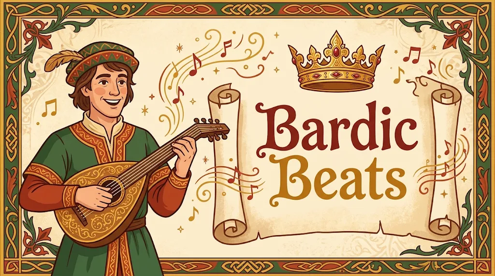

# Bardic Beats

A song-guessing party game where players decode modern hit songs written in fanciful Old English, built for family and friends around a table.

## Play it
Play online at: [ADD YOUR GITHUB PAGES LINK HERE]

You need one phone, tablet, or computer for 1 to 4 players taking turns.

## How to play
1. Pick how many players are sharing the screen (1 to 4) and start the game.
2. Read the Old English song riddle on your turn and type the modern song title.
3. Tap **Hint 1** for a clue about the artist if you are stuck.
4. Tap **Hint 2** to switch to four multiple-choice cards.
5. Score 3 points with no hints, 2 points with one hint, or 1 point with two hints.
6. Play through all rounds and see who has the highest score at the end.

## Play test log
| Round | Who played | Where they got stuck | What I changed |
| :--- | :--- | :--- | :--- |
| 1 | me | 3-player and 4-player games had uneven turn counts | Adjusted the round count so every player gets the same number of turns |
| | | | |

## Made with
Built with Gemini in Vibe Coding for Nonprofits, a Whole Whale × Meet the Moment accelerator.